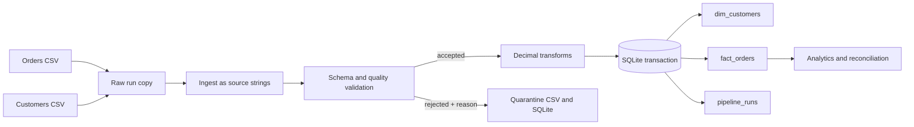

# End-to-End E-Commerce Data Engineering Platform

A local, reproducible pipeline for independent orders and customer CSV systems. It retains raw inputs, validates and quarantines bad rows, transforms accepted records with decimal money arithmetic, and atomically publishes a small dimensional model to SQLite.

## Business problem and aim

Orders and customers arrive from separate systems with separate schemas. The pipeline must preserve source evidence, reject invalid data with reasons, prevent orphan facts, and support safe reruns and useful sales reporting. The project demonstrates a compact vertical slice suitable for a local data engineering hackathon.

## Architecture



## Technology and compatibility

Python 3.11+ is the target; the current workspace run used Python 3.15.2. Pandas reads both CSV sources with string-preserving settings; Python's standard library provides SQLite, logging, decimal arithmetic, and timing. Pytest runs the automated suite. No external service is needed.

## Project structure and module responsibilities

| Path | Responsibility |
|---|---|
| `main.py` | CLI for run, report, status, reconciliation, and safe database reset. |
| `src/config.py` | Central project paths and directory initialization. |
| `src/logger.py` | Console and file logging setup. |
| `src/ingest.py` | CSV reading and run-scoped byte-preserving raw copies. |
| `src/validate.py` | Exact schema checks, field/business rules, duplicates, and customer references. |
| `src/transform.py` | Decimal unit prices and total amount calculation. |
| `src/load.py` | SQLite schema initialization, FK enforcement, upsert and transactional publishing. |
| `src/pipeline.py` | Orchestrates stages, artifacts, metrics, run status, and failure capture. |
| `src/monitor.py` | Reads persisted run history. |
| `src/reconcile.py` | Checks fact uniqueness and valid dimension references. |
| `src/report.py` | Runs and exports analytical reports. |
| `generator/data_generator.py` | Seeded independent source CSV generation with deliberate invalid samples. |
| `database/schema.sql` | Dimension, fact, run, rejection table definitions and indexes. |
| `database/analytics.sql` | Ten reusable business SQL queries. |
| `tests/conftest.py` | Isolated temporary CSV fixtures. |
| `tests/test_*.py` | Ingestion, validation, transformation, loading, reconciliation, and pipeline tests. |
| `scripts/run_demo.py` | Small generate/run/report walkthrough. |
| `scripts/benchmark.py` | Isolated 1k/10k/100k-scale performance measurements. |
| `data/incoming/` | Current input CSVs. |
| `data/raw/<run_id>/` | Immutable copies of the two files read by each run. |
| `data/validated/`, `data/rejects/`, `data/output/` | Per-run validated CSVs, quarantine CSV, and run summaries. |
| `logs/` | Pipeline log. |
| `reports/` | Reserved for report exports. |
| `metadata/` | Reserved for source-specific metadata. |

## Independent source schemas

`orders.csv` fields: `order_id` (unique required string), `customer_id` (customer reference), `product_id`, `quantity` (positive integer), `unit_price` (positive decimal), `event_timestamp` (ISO timestamp).

`customers.csv` fields: `customer_id` (unique required string), `customer_name`, `city`, and `registration_date` (ISO date). Customer attributes are generated from customer-system inputs and never copied from orders. Unknown or missing columns are a visible schema failure.

The seeded generator makes at least ten distinct customers and the requested number of valid base orders. A per-order seed and fixed customer ID pool make a smaller dataset an exact order prefix of a larger dataset with the same seed. By default it adds negative quantity, invalid customer reference, malformed time, negative price, missing quantity, duplicate order and customer keys, plus missing and invalid customer fields. `--clean` omits these cases. It supports 100,000+ base orders.

## Data model and quality policy

`dim_customers` has one row per customer ID. `customer_key` is a stable positive 63-bit integer derived from the customer natural key; the natural key is also unique. Customer changes use Type 1 updates. `fact_orders` has one row per unique order ID, with `customer_key` referencing the dimension. Money is stored as decimal text input bound into SQLite NUMERIC columns; transformation and total computation use `Decimal` at two decimal places.

Validation trims identifiers and descriptive strings. The first valid record for a business key wins; later duplicates are quarantined as duplicates. Missing required fields, invalid dates/timestamps, nonpositive quantity/price, and unknown customer references are rejected with original record and reason. A late but parseable timestamp is accepted. Raw inputs are copied before validation and left unchanged.

## Reliability, reruns, and recovery

Each successful batch writes dimensions, facts, rejects, and the success run row in one SQLite transaction. If any insert fails, all those writes roll back. The pipeline then records a separate `FAILED` run marker with the error. Dimensions use a natural-key upsert; facts use `order_id` and `ON CONFLICT DO NOTHING`. Thus replaying a batch keeps fact counts stable but still creates a separate run record and repeat rejection evidence. Additional new order IDs append normally. Invalid customer references are rejected before loading and protected again by the FK. Retry by rerunning the same command; backfill by supplying the intended CSV files. Type 2 customer history and mutation of already loaded fact details are out of scope.

## Setup and commands (Windows Command Prompt)

From the repository root:

```bat
py -3 -m venv .venv
.venv\Scripts\activate
python -m pip install -r requirements.txt
python -m generator.data_generator --size 1000 --seed 42
python main.py run
python main.py report
python main.py status
python main.py reconcile
python -m pytest -v
python main.py run --orders 100000 --seed 42
python scripts/benchmark.py
```

The generator command creates `data/incoming/orders.csv` and `customers.csv`. `main.py run --orders N` regenerates inputs first, then runs the pipeline. `main.py reset` is a dry run; only `main.py reset --confirm` removes the SQLite demo database. It never removes raw files or historical CSV artifacts.

## Reports, monitoring, and performance

The CLI prints total revenue, order count, total quantity, revenue by city, top customers, daily trends, orders by city, and rejection counts. The matching query collection also includes pipeline history. `report` writes `data/output/analytics.json`; `reconcile` writes `data/output/reconciliation.json`; per-run JSON and quarantine CSVs are written under `data/output/` and `data/rejects/`. `logs/pipeline.log` records stage start/completion and errors.

The run metadata records UTC start/end, elapsed `perf_counter` duration, source counts, accepted order count, rejected count, and newly inserted fact count. Throughput is input rows divided by duration. Stage timings and throughput are written to `data/output/performance_<run_id>.json`. `python scripts/benchmark.py` measures ingestion, validation, transformation, database load, total duration, and throughput at 1,000, 10,000, and 100,000 base orders in isolated temporary databases. One straightforward optimization is batched `executemany` inserts for very large loads; this starter uses parameterized row inserts inside one transaction for clarity.

One observed benchmark on Windows with Python 3.15.2: 1,000 base orders (1,006 input rows) took 0.093 seconds at 10,844 rows/second; 10,000 base orders (10,006 input rows) took 0.279 seconds at 35,859 rows/second; and 100,000 base orders (100,006 input rows) took 9.992 seconds at 10,009 rows/second. All four reconciliation assertions passed at every size, including distinct fact IDs, valid customer references, source orders present in the target, and matching source/target revenue. Timings vary by machine and database state. Run-history sums count source occurrences across executions, so they naturally include replays; `reported_loaded_count_across_runs` is the sum recorded by each historical run, while `fact_orders` is the current distinct target count.

## Test and demo notes

Tests use temporary source files and SQLite databases and do not touch the demonstration database. They cover valid and empty inputs, schema drift, invalid fields, duplicate IDs, out-of-order events, exact totals, raw preservation, FK enforcement, idempotency, and rollback. Run the CLI against the starter files for the end-to-end demonstration.

## Assumptions, trade-offs, and limitations

- CSV headers are exact and schema changes stop the run rather than being silently adapted.
- First occurrence wins for duplicate keys within one source file.
- Existing fact IDs are immutable on replay; changed values do not overwrite an already published fact.
- SQLite NUMERIC affinity may represent bound decimal strings as numeric values; exact arithmetic is done in `Decimal` before binding.
- Pandas is used for schema-aware CSV ingestion; Decimal arithmetic remains in Python to keep money calculations exact before database binding.
- Chunked streaming, SCD Type 2, currencies/tax, configurable source contracts, and dashboard UI are outside scope.
- SQLite schema creation is idempotent. Rejected rows are stored both in run-scoped CSV and in the database.

## Troubleshooting

- `Unexpected ... schema`: check exact header spelling and remove/handle unexpected columns upstream.
- `Source file not found`: generate the files or pass the expected CSVs to `run_pipeline` in Python.
- Test import errors: activate `.venv` and install `requirements.txt` from the repository root.
- Reconciliation reports a revenue mismatch after changing the generator seed: order IDs stay stable by position, while source values change. Run `python main.py reset --confirm` only when you intend to replace the demo database, then rerun the pipeline.
- Inspect `logs/pipeline.log` and `data/output/run_<run_id>.json` for failures.

## Interview explanation

“I built a local batch pipeline that reads orders and customers independently, saves immutable raw copies, validates schemas and business rules, quarantines rejected rows with reasons, calculates totals using Decimal, and publishes a customer dimension and order fact in a SQLite transaction. Business keys and constraints make replays safe, and run metadata plus reconciliation and analytics make each execution observable.”

## Interview practice

1. **Why keep two inputs?** They represent independent systems with different owners and schemas.
2. **Why preserve raw data?** It enables debugging and replay without losing source evidence.
3. **What is the fact grain?** One row per unique order ID.
4. **What is the dimension grain?** One current row per customer ID.
5. **How do you prevent orphan facts?** Validate references and enforce a SQLite foreign key.
6. **How is replay safe?** Unique order IDs plus conflict-do-nothing inserts prevent duplicate facts.
7. **What if the load fails midway?** The transaction rolls back its dimensions, facts, rejects, and success run row.
8. **How are failures observed?** A failed run marker, JSON summary, and exception log are written.
9. **Why Decimal?** Binary floating point cannot exactly represent many decimal prices.
10. **How are duplicate orders handled?** First accepted key wins; later copies are quarantined.
11. **How do schema changes behave?** They fail visibly with expected/missing/unexpected columns.
12. **Can late data load?** A valid older timestamp is retained; no event-time cutoff is applied.
13. **Why SQLite?** It is easy to run locally and supports constraints and transactions.
14. **Why not a scheduler?** A CLI batch is enough for a hackathon-sized vertical slice.
15. **What is Type 1?** Customer attribute changes update the current dimension row.
16. **How would you scale?** Batch inserts, stream large CSVs, and move to a managed analytical database.
17. **What does quarantine contain?** Original columns plus source, run, reject time, and reason.
18. **How do you reconcile?** Compare run source/valid/rejected metrics and assert target uniqueness and FK validity.
19. **How is performance measured?** `perf_counter` duration and source count yield observed throughput.
20. **What is not handled?** Type 2 history, currencies, incremental file manifests, and schema evolution.

### Scenario questions

1. **Database locks during load?** Let the transaction fail, retain the failure record, then retry once the lock clears.
2. **A customer file arrives late?** Keep the orders quarantined or rerun after the correct customer source is available; do not publish orphan facts.
3. **A duplicate order has changed price?** Current policy keeps the first published fact; investigate and define a correction process before updating facts.
4. **A column is renamed?** Stop on schema mismatch, update the contract and tests, then replay raw data.
5. **A timestamp is malformed?** Quarantine the original record and reason; correct upstream or replay after correction.
6. **A 100k load is slow?** Measure stages first, then implement `executemany` and streaming validation.
7. **A run fails after dimensions were staged?** SQLite rollback removes all staged transaction changes; verify counts before retry.
8. **A late event appears?** Accept its event time and group it by that date; source arrival time is separate run metadata.
9. **Quarantine volume spikes?** Group reasons, inspect source version/header and reject samples, and alert on thresholds.
10. **Rerun duplicates rejects?** Run history distinguishes batches; source duplicate handling and batch idempotency are separate concepts.
